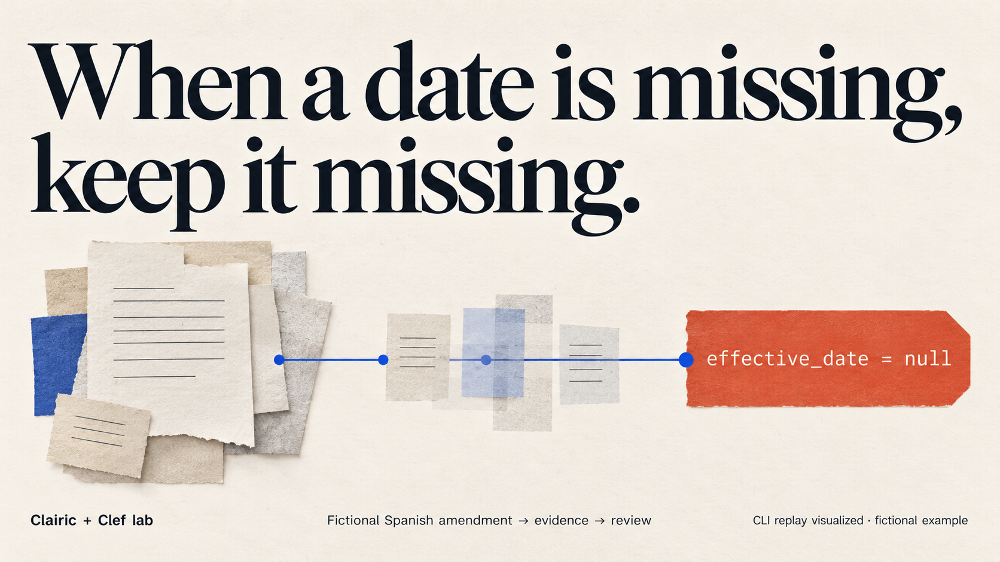
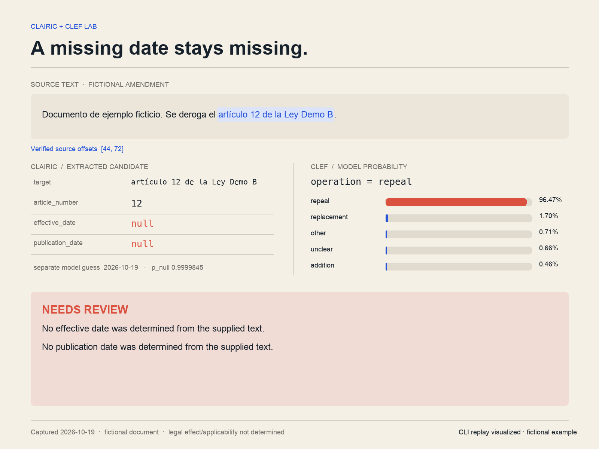
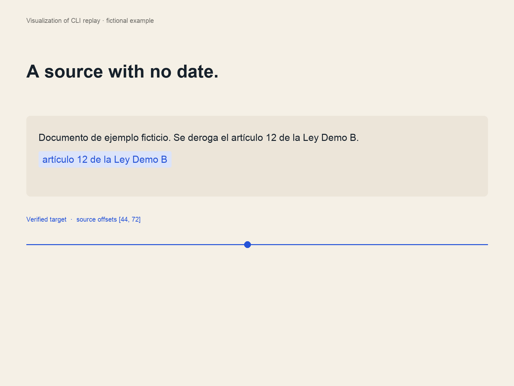

# Clairic + Clef lab

Turn a fictional Spanish amendment into a typed candidate change with inspectable evidence.

- **Clairic** extracts the target, article number, and dates, with source offsets and uncertainty.
- **Clef** chooses among replacement, addition, repeal, other, and unclear, with probabilities.
- **Pydantic AI** validates both outputs through ordinary `Agent` runs.

The result is an intake card for review. It does not compute legal effect or applicability.
All documents and instrument names in this repository are fictional.



## Run without credentials

Install [uv](https://docs.astral.sh/uv/getting-started/installation/), then:

```sh
gh repo clone dsfaccini/clairic-clef-lab
cd clairic-clef-lab
uv run clairic-clef-lab
uv run clairic-clef-lab --replay missing-date
```

Replay reads service results captured on 2026-10-19. It makes no API calls.
The captures include exact request bodies and native JSON results obtained through authenticated Cloudflare MCP.
They are result captures, rather than HTTP recordings or benchmark results.

The replacement example yields this candidate:

```json
{
  "target": "artículo 7 de la Ley Demo A",
  "article_number": 7,
  "effective_date": "2027-03-01",
  "publication_date": null
}
```

Clef selected `replacement`. The complete card includes the source text, verified character offsets,
each field's native evidence, operation probabilities, token usage, and review reasons.

## Replay visuals

These cards visualize the captured missing-date replay. They show the accepted dates as `null`, keep the model's guess separate, and route the candidate to review.





The GIF has an MP4 counterpart at [assets/replay.mp4](assets/replay.mp4). Regenerate the card and animation with `uv run --with pillow python scripts/render_media.py`; provenance and the cover-generation prompt are in [assets/README.md](assets/README.md).

## Run live

Create a Cloudflare API token with Workers AI access and supply your account ID:

```sh
export CLOUDFLARE_ACCOUNT_ID='your-account-id'
export CLOUDFLARE_API_TOKEN='your-api-token'
uv run clairic-clef-lab --file examples/amendment.txt
```

Live runs send the file to Cloudflare. The replay fixtures require no credentials.
The token stays in the environment; `.env` is ignored. `.env.example` lists the variable names,
but the application does not load an environment file automatically.

The core application uses the same API for both models:

```python
from pydantic_ai import Agent
from clairic_clef_lab.cli import AmendmentFacts, Decision

extractor = Agent('cloudflare:@cf/cloudflare/clairic', output_type=AmendmentFacts)
decider = Agent('cloudflare:@cf/cloudflare/clef', output_type=Decision)
```

Clairic support is in Pydantic AI [PR #10635](https://github.com/pydantic/pydantic-ai/pull/10635),
stacked on the [Clef integration](https://github.com/pydantic/pydantic-ai/pull/10557).
The lockfile pins that code and its matching `pydantic-graph` package until the integration is released.

## Inspect uncertainty

The missing-date example intentionally contains no date. Clairic returned `value: null` for the
effective date while also returning a guessed date and a high confidence value. The application
keeps the result null and preserves `guess`, `confidence`, and `p_null` independently.

Text offsets are checked against the exact state supplied by the provider. An invalid span is
left unverified. Truncated input is surfaced as a review reason. The application does not use
an arbitrary confidence threshold to accept a candidate automatically.

The saved cases demonstrate wiring and evidence handling. They do not measure Spanish-language
accuracy or calibrate confidence thresholds.

## Develop

```sh
uv sync --locked
uv run pytest -q
uv run ruff check src tests
```

Tests cover missing values despite available guesses, Unicode source offsets, and invalid or
truncated provenance. CI also runs both replay cases without credentials.

The application is in [cli.py](src/clairic_clef_lab/cli.py). Captures are in
[captures/](src/clairic_clef_lab/captures/). [Five demo directions](docs/ideas.md) describes follow-on examples.

## Model references

- [Clairic announcement](https://blog.cloudflare.com/clairic-extraction-model/)
- [Clairic API and preview limitations](https://developers.cloudflare.com/workers-ai/models/clairic/)
- [Extraction semantics](https://developers.cloudflare.com/workers-ai/concepts/extraction-models/)
- [Clef API](https://developers.cloudflare.com/workers-ai/models/clef/)
